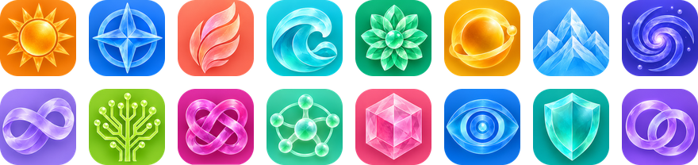
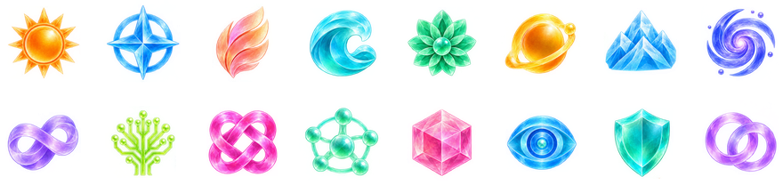
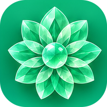
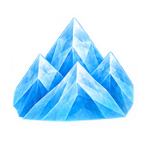
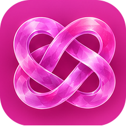
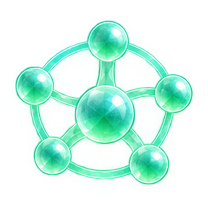
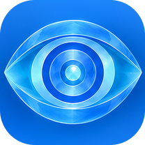
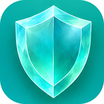
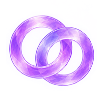

# RuleNova icons

16 original icons in two styles, for policy groups and other places where a network client shows a custom icon.

**Solid** — on a rounded colour tile



**Transparent** — no background



## Usage

Both styles use the same file names, so switching style only changes the folder in the URL:

```text
https://cdn.jsdelivr.net/gh/harryheros/rulenova@main/icons/solid/<name>.png
https://cdn.jsdelivr.net/gh/harryheros/rulenova@main/icons/transparent/<name>.png
```

Example for a Quantumult X policy group:

```ini
static=Streaming, proxy, direct, img-url=https://cdn.jsdelivr.net/gh/harryheros/rulenova@main/icons/solid/blue-compass.png
```

Other clients that support custom policy-group icons use the same URLs in their own icon field. The files are served through jsDelivr, which is reachable in many networks where raw.githubusercontent.com is blocked or slow.

## All icons

| Solid | Transparent | Name |
|:-----:|:-----------:|------|
|  |  | `amber-sun` |
|  |  | `blue-compass` |
|  |  | `coral-flame` |
|  |  | `cyan-wave` |
|  |  | `emerald-lotus` |
|  |  | `golden-orbit` |
|  |  | `ice-mountains` |
|  |  | `indigo-spiral` |
|  |  | `lavender-infinity` |
|  |  | `lime-circuit` |
|  |  | `magenta-knot` |
|  |  | `mint-network` |
|  |  | `rose-crystal` |
|  |  | `sapphire-eye` |
|  |  | `teal-shield` |
|  |  | `violet-links` |

## Details

- PNG, 208×208 px, RGBA. Solid icons have transparent rounded corners.
- File names are lowercase; URLs are case-sensitive.
- `sources/scripts/test_icons.py` checks in CI that both styles contain the same icons, every file is a valid 208×208 RGBA PNG, and every icon is listed here.
- After adding or changing icons, regenerate the previews with `python3 sources/scripts/build_icon_preview.py` (requires Pillow).

## License

The icons are original artwork of this project and are covered by the repository license, [CC BY-NC-SA 4.0](../LICENSE): free for non-commercial use with attribution. Commercial use requires prior written permission — see [COMMERCIAL_LICENSE.md](../COMMERCIAL_LICENSE.md).
